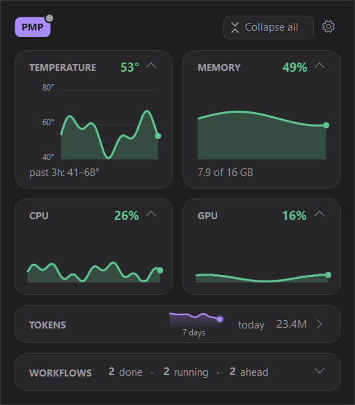
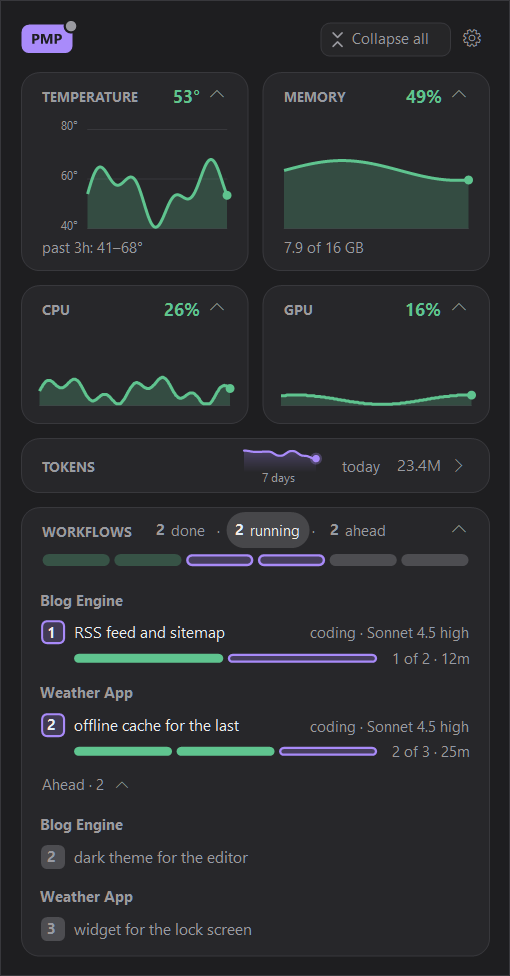
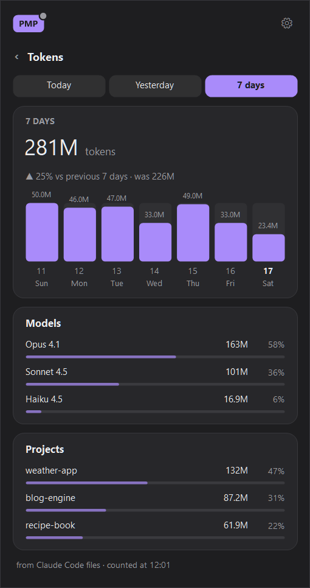
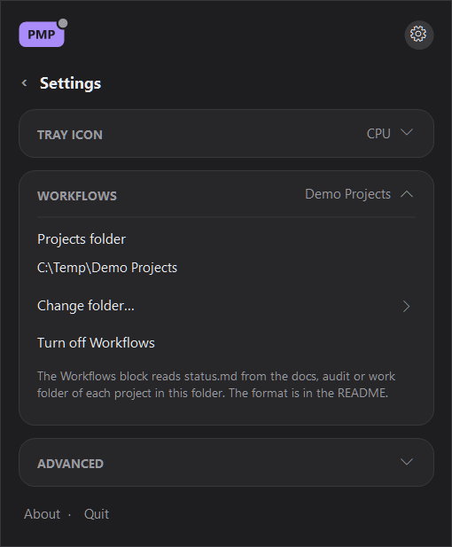
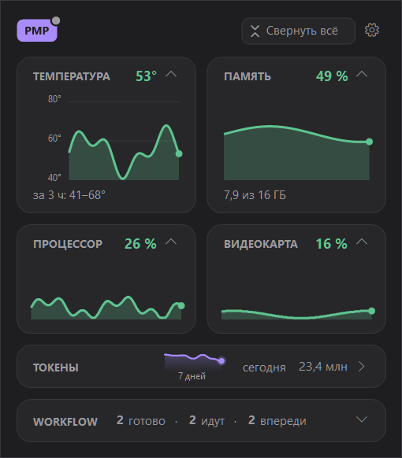
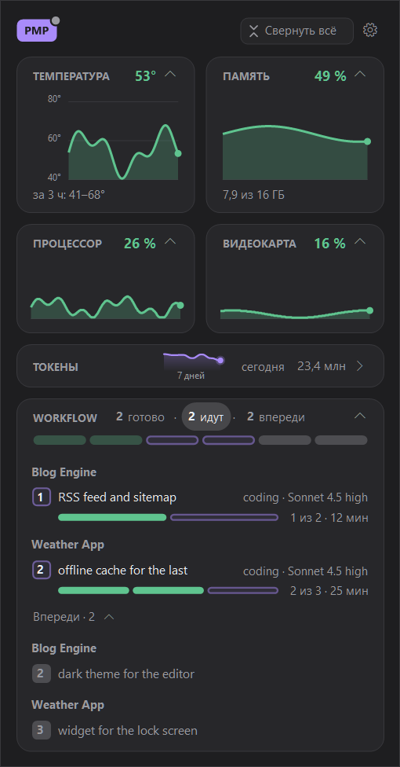

# PMP Tray for Windows

A small panel next to the Windows clock: temperature, memory, CPU and GPU load, Claude Code token usage per day and, if you want, the progress of your Workflows from `status.md` files. The tray icon shows CPU load or today's tokens.

> **Unofficial. Not affiliated with Anthropic.** "Claude" and "Claude Code" are names of Anthropic products; this app only reads files that Claude Code leaves on your computer.

[Русский — ниже](#по-русски)

<p>
  
  
</p>

## What it does

- **Tray icon** — CPU load in percent (yellow from 70 %, red from 90 %) or today's Claude Code tokens (`850`, `12K`, `3.2M`). Pick one in Settings → Tray icon. Hover for the full number.
- **Temperature** — the hottest ACPI thermal zone, with a 3-hour chart. Some laptops expose no thermal zones; then the block says "no sensor".
- **Memory, CPU, GPU** — current load and a 3-hour chart. GPU load is counted like Task Manager does (the busiest engine type).
- **Tokens** — tokens per day for the last 7 days; click the row for today / yesterday / 7 days with models and projects.
- **Workflows** (off by default) — running, done and planned workflows read from `status.md` files in a projects folder you choose. Click a row for details; arrows, the mouse wheel or a swipe page through them.

Colors: green is fine, yellow is high, red is critical. Temperature: under 80° / 80–90° / above. CPU and GPU: under 70 % / 70–90 % / above. Memory: under 75 % / 75–90 % / above.

## Privacy

The app reads only local files and Windows performance counters. It makes no network requests, sends nothing anywhere and needs no admin rights.

- Tokens come from `%USERPROFILE%\.claude\projects\**\*.jsonl` (Claude Code transcripts): only the `usage` numbers, model, time and working folder of each reply are read.
- Workflows come from the `status.md` files in the folder you pick, and only after you pick it.
- Settings, the token cache and a small log live in `%LOCALAPPDATA%\PimpTray`.

## Install

You need Windows 10 or 11 (x64). The compiler comes with .NET Framework 4.8, which is part of Windows, so nothing else is needed.

```powershell
git clone <this repository>
cd pimp-tray
powershell -ExecutionPolicy Bypass -File build.ps1
.\PimpTray.exe
```

On the first start PMP Tray turns on **Start with Windows** for itself (Settings → Advanced, switch it off if you don't want it). Only one copy runs at a time.

Uninstall: Settings → Advanced → turn off Start with Windows, then Quit and delete the folder and `%LOCALAPPDATA%\PimpTray`.

## Using the panel

- **Left-click** the tray icon — open or close the panel. **Right-click** — Settings, language, About, Quit.
- **Click a block header** — collapse or expand it. **Collapse all / Expand all** — the button at the top.
- **Right-click a block** — half or full width, Hide, Keep expanded (the block stays open every time the panel opens), Reset layout, language. Hidden blocks come back from the **Hidden** row at the bottom.
- **Press and hold** a block, then drag — move it. Esc puts everything back.
- **PMP badge** (top left) — the PMP color: the tray icon and the accents of the panel.
- **Ctrl+,** — Settings. **Esc** — one step back, then close.

The interface is in English or Russian; by default it follows the Windows display language.

<p>
  
  
</p>

## How tokens are counted

Every assistant reply in a Claude Code transcript has a `usage` record. PMP Tray adds input + cache write + cache read + output tokens; a reply that is written as several lines with the same message id and request id is counted once. It keeps 14 days. Finished days are cached in `tokens.json`, so after a restart only new lines are read. A project is the top folder under your Workflows projects folder (git worktrees count as their main repository), otherwise the name of the working folder.

## Workflows and the `status.md` format

Settings → Workflows → **Choose folder…** — the folder that holds your projects, one subfolder per project. For every project PMP Tray reads the first of `docs\status.md`, `audit\status.md`, `work\status.md` (up to 128 KB) once a minute and when the panel opens. Folders starting with `.` and working copies (names ending in `-wf<N>`, `-rev`, `-inst<N>`, or git worktrees with a `.git` file) are skipped.

```markdown
# 🌦 Weather App
updated 14:05

1️⃣ Workflow — running 💭
- about: offline cache for the last forecast
- 13:40 → … · running
- steps 2 of 3
- past steps: planning · 1 agent · Opus 4.1 high — plan approved
- coding · 2 agents · Sonnet 4.5 high 💭
- review · 1 agent · Opus 4.1 high

2️⃣ Workflow — planned ⬜
- about: widget for the lock screen

Now: wiring the cache into the forecast screen
Waiting: pick the cache lifetime
```

- `# Name` — the project name (an emoji in front is just decoration). An optional `updated HH:MM` line right under it says when the file was written.
- A workflow block starts with a keycap digit: `1️⃣` … `9️⃣`, `🔟`. Its state comes from an emoji in that line — running `💭` `⏳`, waiting `✋` `⚠` `❓` `🙋` `⏸`, failed `🛑` `❌`, done `✅` `🟢`, planned `⬜` — or, without an emoji, from a word: running / coding / review / testing, waiting / paused, failed / stopped, done / shipped, planned / queued / ahead. Neither — planned.
- List items of a block (`- `): the first plain item is what the workflow is about (`about:` is optional); the first item with a time is its timing (`start → end · duration`); `steps N of M` is the progress; `past steps: role — result; role — result` lists finished stages; items like `role · N agents · model` are stages, and `💭` marks the one working now.
- `Now:` and `Waiting:` lines anywhere in the file: what is going on and what the project waits for from you.
- An `about` that starts with `Name:` (for example `Website: new header`) is shown under the project `Name` — handy when one `status.md` tracks several projects.

**Running** shows the workflows of projects that have something running or failed (with their waiting ones) in files changed in the last 12 hours; **Done** and **Ahead** — from files changed in the last 24 hours. Click a number in the block header to filter; click it again to go back to running.

## Build from source

`PimpTray.cs` is the whole app (C# 5, WinForms, no NuGet packages). `build.ps1` calls `csc.exe` from .NET Framework 4.8 with `/define:PUBLIC` and puts `PimpTray.exe` next to it.

## License

MIT — see [LICENSE](LICENSE).

---

## По-русски

**PMP Tray для Windows** — панелька у часов: температура, память, нагрузка процессора и видеокарты, токены Claude Code по дням и, если нужно, ход Workflow из файлов `status.md`. Значок у часов показывает нагрузку процессора или токены за сегодня.

> **Неофициальная программа, не связана с Anthropic.** Она только читает файлы, которые Claude Code оставляет на компьютере.

<p>
  
  
</p>

**Что показывает.** Значок — нагрузка процессора (жёлтый от 70 %, красный от 90 %) или токены за сегодня (`850`, `12K`, `3.2M`), выбор — «Настройки → Значок у часов». Температура — самая горячая тепловая зона ACPI с графиком за 3 часа (на части ноутбуков датчика нет — «нет датчика»). Память, процессор, видеокарта — нагрузка и график за 3 часа. Токены — по дням за 7 дней, по нажатию — сегодня, вчера, 7 дней, модели и проекты. Workflow (по умолчанию выключено) — идущие, готовые и запланированные из `status.md` в выбранной папке проектов. Цвета: зелёный — нормально, жёлтый — много, красный — критично.

**Приватность.** Программа читает только файлы на этом компьютере и счётчики Windows, в сеть не ходит, ничего никуда не отправляет, прав администратора не просит. Токены — из `%USERPROFILE%\.claude\projects\**\*.jsonl` (только числа `usage`, модель, время и рабочая папка ответа). Настройки, кеш токенов и журнал — в `%LOCALAPPDATA%\PimpTray`.

**Установка.** Windows 10 или 11 (x64), компилятор есть в .NET Framework 4.8 из состава Windows:

```powershell
powershell -ExecutionPolicy Bypass -File build.ps1
.\PimpTray.exe
```

При первом запуске включается «Запускать вместе с Windows» («Настройки → Дополнительно», можно выключить). Удаление: выключить автозапуск, «Выйти», удалить папку и `%LOCALAPPDATA%\PimpTray`.

**Панель.** Левая кнопка по значку — открыть или закрыть, правая — настройки, язык, «О программе», «Выйти». Нажатие на заголовок блока — свернуть или развернуть; «Свернуть всё» — кнопка сверху. Правая кнопка по блоку — половина или вся ширина, «Скрыть блок», «Оставлять раскрытым», «Вернуть как было», язык; скрытые возвращаются из строки «Скрытые» внизу. Долгое нажатие на блок — перетащить, Esc — как было. Плашка PMP слева сверху — цвет PMP. Ctrl+, — настройки, Esc — шаг назад. Язык — русский или английский, по умолчанию — как у Windows.

**Workflow и формат `status.md`.** «Настройки → Workflow → Выбрать папку…» — папка, где лежат проекты, по папке на проект. В каждом проекте читается первый из `docs\status.md`, `audit\status.md`, `work\status.md` (до 128 КБ) раз в минуту и при открытии панели; папки с точкой в начале и рабочие копии (`-wf<N>`, `-rev`, `-inst<N>`, git worktree) пропускаются. Формат — как в примере выше; русские слова тоже понимаются:

```markdown
# 🔰 Мой проект
обновлено 14:05

1️⃣ Workflow — идёт 💭
- о чём: офлайн-кеш прогноза
- 13:40 → … · идёт 25 мин
- шаги 2 из 3
- прошлые шаги: планирование · 1 агент · Opus 4.1 high — план принят
- кодинг · 2 агента · Sonnet 4.5 high 💭

Сейчас: подключаю кеш к экрану прогноза
Ждёт пользователя: выбрать срок жизни кеша
```

Блок начинается с цифры-клавиши (`1️⃣` … `🔟`), состояние — значком (`💭` идёт, `✋` ждёт, `🛑` упал, `✅` готово, `⬜` впереди) или словом (идёт, ждёт, упал, готово, запланирован). «Идут» — проекты, где что-то идёт или упало (вместе с их ждущими), из сводок свежее 12 часов, «готово» и «впереди» — свежее суток; нажатие на число в шапке блока — фильтр, повторное — снова идущие.

**Сборка.** Вся программа — `PimpTray.cs` (C# 5, WinForms, без пакетов NuGet); `build.ps1` вызывает `csc.exe` из .NET Framework 4.8 с `/define:PUBLIC`.

Лицензия — MIT, автор — Kozireva2030.
